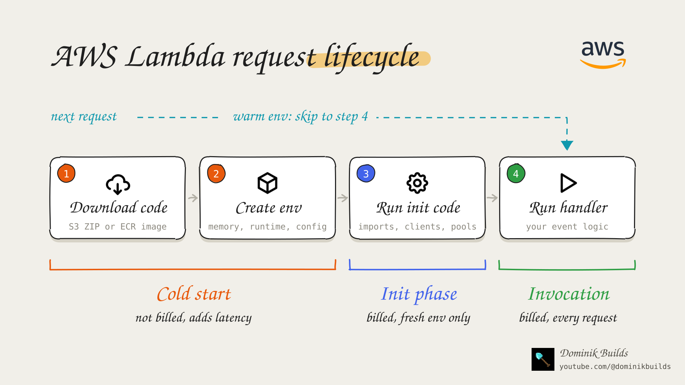

If you want to save money and speed up your Lambda stack, you're in the right place.

I read the brick-thick, ugly docs on Lambda optimization (no offense, AWS), and today I'll share what actually works.

## How the Lambda lifecycle works

To optimize Lambda, you need to know what happens when it receives a request:

1. **Download the code.** Lambda fetches your function code. Fun fact: ZIP packages live in an internal S3 bucket; container images live in ECR.
2. **Create the environment.** Lambda starts an execution environment with the memory, runtime, and configuration you specified.
3. **Run the init code.** Lambda runs everything outside your handler: imports, clients, connection pools.
4. **Run the handler.** Your handler processes the event.



Steps 1 and 2 are the famous **cold start**🥶. You don't pay for them, but they add latency. Step 3 counts as billed duration, even though it runs only in a fresh environment.

## How long does a Lambda stay warm?

Lambda doesn't tear down the environment right after the response. If the next request arrives soon enough, it skips straight to step 4. That's a **warm** Lambda: AWS reuses the existing environment.

So how long does it stay warm? Nobody outside AWS knows, and you'll find plenty of made-up numbers online. Here's what [AWS says in its performance optimization guide](https://aws.amazon.com/blogs/compute/operating-lambda-performance-optimization-part-1/):

> ...the Lambda service retains the execution environment for a non-deterministic period of time.

AWS also [claims](https://aws.amazon.com/blogs/compute/operating-lambda-performance-optimization-part-1/) cold starts happen in under 1% of invocations. In my experience, they happen much more often, especially on low-traffic functions.

## Why concurrent requests cause extra cold starts

Say the environment is warm and two requests arrive at the same time. The first one reuses the warm environment; the second one gets a brand-new environment with a full cold start. Lambda never queues the second request, even when waiting would be faster and cheaper. Five concurrent requests mean five environments.

The default concurrency limit, per the [Lambda concurrency docs](https://docs.aws.amazon.com/lambda/latest/dg/lambda-concurrency.html):

> ...Lambda provides your account with a total concurrency limit of 1,000 concurrent executions across all Event Functions in an AWS Region.

AWS Support can raise it, but even the default goes far. At 200 ms per request, 1,000 concurrent executions handle 5,000 requests per second.

## How to reduce cold starts

You have three options:

- **Ping the function every few minutes** – the rookie way. It keeps one environment warm and does nothing for concurrent spikes.

- **Use Provisioned Concurrency** – AWS keeps a set number of environments initialized at all times. It works, but it gets expensive and breaks the "no traffic, no cost" model.

- **Keep the function lean** – my favorite, and it's free.

A smaller package downloads and initializes faster. In Node.js:

- Audit your dependencies and remove what you don't need.

- Bundle with [esbuild](https://esbuild.github.io/) so tree-shaking strips unused code.

- Use the modular [AWS SDK for JavaScript v3](https://docs.aws.amazon.com/sdk-for-javascript/v3/developer-guide/welcome.html). If your function only writes to S3, import `@aws-sdk/client-s3`, not the whole SDK.

## How to choose Lambda memory (and CPU)

You can set Lambda memory anywhere from 128 MB to 10,240 MB. You can't set CPU directly: AWS allocates CPU in proportion to memory, so more memory means more CPU.

That's why a bigger Lambda is sometimes **cheaper** than a small one. Lambda bills memory × duration, so if 30% more memory makes the function finish twice as fast, you pay less.

There's no universal best setting. Use [AWS Lambda Power Tuning](https://github.com/alexcasalboni/aws-lambda-power-tuning): it runs your function with several memory configurations and shows you the cheapest and the fastest one.

## How to optimize Lambda init code

The init phase (step 3) is the optimization people forget, and it hurts the most. [AWS says it plainly](https://aws.amazon.com/blogs/compute/operating-lambda-performance-optimization-part-2/):

> ...data shows that the largest contributor of latency before function execution comes from INIT code.

### Reuse connections across invocations

Don't create and close a database pool on every request. Define it outside the handler, and every invocation in that environment shares it:

```ts
import { Pool } from "pg";

// Created once per environment, reused by every warm invocation
const pool = new Pool({ connectionString: process.env.DB_URL, max: 1 });

export const handler = async (event: { userId: string }) => {
  const { rows } = await pool.query("SELECT name FROM users WHERE id = $1", [
    event.userId,
  ]);
  return { name: rows[0]?.name };
};
```

The same applies to AWS SDK clients, HTTP clients, and parsed config.

### Don't leak data between requests

Module-level state survives between invocations, and that's a security risk. In this example, a request without a `userId` returns the user from the previous request:

```ts
let currentUser: string; // ❌ survives between requests

export const handler = async (event: { userId?: string }) => {
  if (event.userId) currentUser = event.userId;
  return { user: currentUser };
};
```

Keep request data inside the handler:

```ts
export const handler = async (event: { userId?: string }) => {
  const currentUser = event.userId; // ✅ scoped to this request
  return { user: currentUser };
};
```

Rule of thumb: share clients and connections, never share request data.

## Should you run Lambda on ARM or x86?

Lambda runs on x86 and ARM (AWS Graviton). Pick ARM for almost every function: AWS prices it about 20% lower per GB-second, and it's usually as fast or faster.

[An ARM vs. x86 benchmark on the AWS Partner Network blog](https://aws.amazon.com/blogs/apn/comparing-aws-lambda-arm-vs-x86-performance-cost-and-analysis-2/) backs this up:

> ...we see the benefits of migrating from x86 to Arm-based AWS Lambda functions are almost universal. ... The sole exception is memory-heavy workloads.

## TL;DR

Keep your Lambda lean, tune memory with Power Tuning, create clients outside the handler (but never store request data there), and run on ARM.

---

## FAQ

<details>
<summary>Am I billed for Lambda cold starts?</summary>

You aren't billed for downloading the code or creating the environment. You are billed for the init phase, the code that runs outside your handler.

</details>

<details>
<summary>How long does a Lambda function stay warm?</summary>

AWS doesn't say. It retains the environment for a "non-deterministic period of time", so don't build anything that depends on it.

</details>

<details>
<summary>Is more Lambda memory more expensive?</summary>

Not always. More memory also means more CPU, so the function can finish fast enough to cost less overall. Measure it with AWS Lambda Power Tuning.

</details>

<details>
<summary>Should I use ARM or x86 for AWS Lambda?</summary>

Use ARM (AWS Graviton) for almost every function. It costs about 20% less per GB-second and is usually as fast or faster. The exception is memory-heavy workloads, where x86 can still win.

</details>
